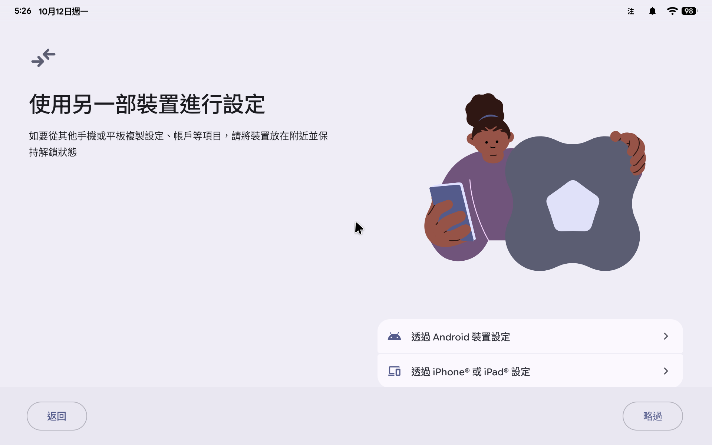

# Googlebook Anywhere

[中文](README.md) | **English**

Installs Google's official **Googlebook OS** (lapis, the desktop edition of Android 17) on x86-64 computers that do not normally support it. The first target model is
**Acer Chromebook Spin 714 (KANO mainboard)**.

- Downloads and release notes: [GitLab Releases](https://gitlab.com/aa22396584/googlebook-anywhere/-/releases) (latest v0.2.1, see [docs/RELEASE-NOTES.md](docs/RELEASE-NOTES.md) (Chinese))
- Source code and issues: [gitlab.com/aa22396584/googlebook-anywhere](https://gitlab.com/aa22396584/googlebook-anywhere) (the primary repo). [akari-sora/googlebook-anywhere](https://github.com/akari-sora/googlebook-anywhere) on GitHub is a read-only mirror; use GitLab for issues and downloads.

> This is not an official Google project. The repo contains no Google files: the scripts download the official recovery image from Google, check it against a fixed SHA-256,
> and build a bootable image on your own computer. It does not flash firmware and does not write SPI/EC/Cr50.

## At a glance

| Item | Status |
|---|---|
| Verified on hardware | Only one KANO: an Alder Lake-P K0 engineering sample with iGPU `8086:46a6` |
| Other KANO models | 12th-gen CP714-1WN and 13th-gen CP714-2WN/Zydron (i3/i5/i7): their iGPU IDs and the 13th-gen audio firmware have been added; they should work, **not yet tested on hardware** |
| Minimum CPU | Intel 12th gen or AMD Zen 5 and newer; older CPUs are expected not to boot ([docs/COMPATIBILITY.en.md](docs/COMPATIBILITY.en.md) "Minimum CPU") |
| Other x86-64 computers | Experimental `generic-x86` and `amd-hx370`, verified only in QEMU |
| How to install | Build the image yourself (about 10–30 minutes, plus a 7.7 GB download and 80 GB of disk) → write it to a USB stick and boot; to install to the internal disk, use the "installer stick" |
| Safety | Known firmware updaters are removed, and the kernel paths to the EC/TPM/SPI are blocked; see [docs/SAFETY.md](docs/SAFETY.md) (Chinese) |

<details>
<summary>Original description (full description of models and iGPU IDs)</summary>

Installs Google's official **Googlebook OS** (lapis, the desktop edition of Android 17) on x86-64 computers that do not normally support it. The target models are the
**Acer Chromebook Spin 714 family (12th-gen CP714-1WN and 13th-gen CP714-2WN/Zydron, i3/i5/i7)**, which share the **KANO** mainboard;
**so far only one of their SKUs has been tested on hardware (an Alder Lake-P K0 engineering sample with iGPU `8086:46a6`)**. For the other KANO sub-models, the iGPU PCI IDs and the 13th-gen SOF audio firmware have been added (they should work, but are not yet tested on hardware; see [docs/STATUS-KANO.md](docs/STATUS-KANO.md) (Chinese)).
**v0.2.0 allows only iGPU `46a6`; SKUs with other iGPU IDs get a black screen (for the retail SKUs and the SKUs listed by coreboot that were never booted on this machine, this is an inference).**

</details>

## Screenshots

| Acer Chromebook Spin 714 (KANO), real hardware | Same machine, setup wizard | Regular x86 computer (`generic-x86`, QEMU) |
|---|---|---|
|  |  |  |

The first two are screenshots from KANO hardware (a fresh image booted to the setup wizard, 2026-10-12). The third is the generic image in QEMU:
it boots from the firmware all the way to the setup wizard, and the picture comes from the firmware framebuffer plus CPU rendering (2026-10-13, an image built by `install.sh`, the new-user flow).

## Status (KANO hardware)

| Feature | Status |
|---|---|
| Desktop, Wi-Fi, Bluetooth, touchpad, keyboard, speakers, microphone, power button | ✅ Works |
| Lid sleep/wake, battery level, "charging" indicator | ✅ Works (since v0.2) |
| Touchscreen, stylus | 🟡 Detected, no real tap test yet |
| Headphone jack, USB-C data and external display | ⚪ Not verified |
| Waking with the keyboard while the screen is off | ⚠️ Known issue; use the power button or open and close the lid |
| Auto-rotate, light sensor, keyboard backlight adjustment | ❌ Not available (they go through the EC: deliberately blocked, or not supported by the hardware itself) |
| Built-in camera | 🔧 In development, off by default |

For how each item was verified, see [docs/STATUS-KANO.md](docs/STATUS-KANO.md) (Chinese).

<details>
<summary>Full description (standby, wake filtering, model mapping)</summary>

KANO is usable day to day: the desktop, Wi-Fi, Bluetooth, touchpad, keyboard, speakers, microphone, power button and lid sleep/wake have all been verified on hardware;
the touchscreen and stylus are detected, but no real tap test has been done yet. For how each item was verified, see [docs/STATUS-KANO.md](docs/STATUS-KANO.md) (Chinese).

What does not work: auto-rotate and the light sensor, keyboard backlight adjustment (all of these go through the EC: deliberately blocked, or not supported by the hardware itself), and the built-in camera (in development, off by default).
"Charging" icon: since v0.2 the image includes the ACPI charger driver (`ac.ko`, reads ACPI only, sends no EC commands); on KANO hardware, Android shows charging when the charger is plugged in (2026-10-13).
Standby: in v0.1, the screen lights up again by itself within tens of seconds after you close the lid or turn off the screen (every dark wake carries a power-button `KEY_WAKEUP`); since v0.2 the image includes
`gbos_wakefilter.ko`, which drops that key event when the power button did not wake the system. On KANO hardware, with the lid closed for 300 seconds there were 10 dark wakes and the screen never lit up; with the screen off, pressing the power button turns it on, and opening the lid turns the screen on.
**Known issue**: pressing the keyboard while the screen is off may not wake the screen (the module has already dropped the `KEY_WAKEUP` before the key press that woke the machine reaches Android). This is a known issue and is not fixed in v0.2.1; use the power button or open and close the lid.

**Hardware verification was done on only one KANO (`8086:46a6`, an Alder Lake-P K0 engineering sample)**: of the 12 iGPU IDs in `profiles/kano`, 7 map to retail KANO SKUs, and 5 (`46a3`, `46b2`, `a721`, `a7ac`, `a7ad`) are platform candidates (members of the ADL-P/RPL-U macros) whose KANO mapping is not confirmed; see [docs/COMPATIBILITY.en.md](docs/COMPATIBILITY.en.md). The retail mapping is in STATUS-KANO and COMPATIBILITY (Acer retail models and the coreboot KANO list). It covers ADL-P/U on the 12th-gen CP714-1WN and RPL-U on the 13th-gen CP714-2WN/Zydron, including single-channel variants; it is a subset of `adl_p_desc` (no `*`) plus the ADL/RPL SOF firmware, but apart from the `46a6` engineering sample, none of the production SKUs has been tested on hardware yet (for each SKU's status and what is left to test, see [docs/STATUS-KANO.md](docs/STATUS-KANO.md) (Chinese) and [docs/FIRMWARE.md](docs/FIRMWARE.md) (Chinese)). Since v0.2 there is also an experimental `profiles/generic-x86`, for
x86-64 UEFI computers whose GPU has no driver in the Googlebook kernel (for example AMD; the CPU must be Intel 12th gen or AMD Zen 5 and newer, and older ones are expected not to boot, see [docs/COMPATIBILITY.en.md](docs/COMPATIBILITY.en.md) "Minimum CPU"): it uses the firmware's display output (GOP framebuffer) plus CPU rendering (SwiftShader) and boots to the setup wizard in QEMU (`-cpu host`), with no
GPU acceleration. It has not been tested on any physical PC yet; see "Other x86-64 computers (experimental)" below. For adapting a new model, see [docs/NEW-DEVICE.md](docs/NEW-DEVICE.md) (Chinese).
If your machine boots, use "Report your machine" to generate `summary.md` and paste it into [`.gitlab/issue_templates/new-machine.md`](.gitlab/issue_templates/new-machine.md) (Chinese)
or [`.gitlab/issue_templates/bug.md`](.gitlab/issue_templates/bug.md) (Chinese).

</details>

## Installation

Before use, read [docs/SAFETY.md](docs/SAFETY.md) (Chinese), especially "Data safety trade-offs": `/data` is not encrypted. If you run into problems, check [docs/TROUBLESHOOTING.en.md](docs/TROUBLESHOOTING.en.md) first.

### 1. Switch to UEFI firmware (once)

Follow [docs/FIRMWARE.md](docs/FIRMWARE.md) (Chinese): after entering developer mode, first run the read-only `install/kano-check.sh` to confirm there are no known blockers
(`GO` does not guarantee that flashing will succeed), then use MrChromebox's official script to switch to the UEFI Full ROM (you need a SuzyQ cable to disable write protection).
This step can brick the machine. This project does not flash for you; the official documentation is the authority on everything.

### 2. Build the image (on your computer, about 10–30 minutes, not counting the 7.7 GB download)

Google's image cannot be redistributed, so everyone has to build it once from the official zip. The script downloads, checks and builds automatically. You need about 80 GB of disk space.

| Your computer | Command |
|---|---|
| **Linux** (x86-64) | `install/install.sh --work ~/gbos-work` |
| **Windows** (WSL2, recommended) | Follow the Linux steps inside Ubuntu on WSL (missing packages and the commands to install them are printed on screen). Without KVM, add `--no-selftest` (the image will not go through the QEMU self-test). To use Docker Desktop, also run `install/docker-install.sh` inside WSL (turn on Docker Desktop's WSL integration); this script needs bash, so do not run it in PowerShell or cmd |
| **macOS** (Docker Desktop) | `install/docker-install.sh --work ~/gbos-work` (Docker's disk limit must be 80 GB or more; Apple silicon uses x86 emulation, which is slower) |

Paths given to `docker-install.sh` (the repo, `--work`, `--zip`, and so on) must not contain `:`. When a Linux host has KVM, the container gets the `/dev/kvm` group and still runs the QEMU self-test.

<details>
<summary>What <code>install.sh</code> does (click to expand)</summary>

`install.sh` does not need root. In order, it does the following:

1. Downloads the official recovery zip from Google and checks its SHA-256. Only the verified lapis build `16452207` (`CL3B.260622.271.R1`) is accepted.
2. `base/build-base.sh` rebuilds the base image (an intermediate artifact that cannot boot directly), swaps in software KeyMint/Gatekeeper, and re-signs it with **your own newly generated AVB key**
   (`~/gbos-work/base/keys/vbmeta.pem`). otatools and two APEXes come from public builds on ci.android.com.
3. `builder/fetch-inputs.sh` fetches the KANO firmware and audio configuration from linux-firmware, sof-bin and ChromiumOS board-overlays.
   The KANO ACPI charger driver `ac.ko` is built by `builder/kmod/build-ac.sh` from pinned kernel source and a pinned toolchain (an extra download of about 2.5 GB; about 9 GB of temporary files is deleted after the build),
   and the same kernel tree then builds `gbos_wakefilter.ko` (`builder/kmod/build-gbos_wakefilter.sh`).
4. `builder/build.sh` produces the KANO image, then boots it in QEMU as a self-test (an Android boot check, and the whole boot chain starting from the image's own ESP).
   `docker-install.sh` skips this step on hosts without KVM (for example macOS), or when `--no-selftest` is given, and leaves a `.not-self-tested`
   marker next to the image. **Such an image has not been boot-verified in QEMU**; it has only had the build-time checks.

On a 12-thread Linux host with NVMe this takes about 10 minutes (base 2.5 minutes, the image and the two QEMU tests 7.5 minutes).

</details>

### 3. Write the USB stick and boot

The output is `~/gbos-work/build/image/googlebook-kano.img`; the `.sha256` next to it is its checksum. **Writing erases the whole USB stick.**

- **Linux**: `sudo install/write-usb.sh ~/gbos-work/build/image/googlebook-kano.img /dev/disk/by-id/usb-<your-stick>`
  (it accepts only a whole USB disk, refuses the system disk and disks in use, asks you to type the disk's serial number to confirm, reads back the whole write and compares it, then moves the backup GPT to the end of the stick and checks it).
  You need `sgdisk` first (the `gdisk` package); without it, the script stops without writing anything. If there is a `.not-self-tested` marker next to the image, you also have to type `untested` before it writes.
  By default it also gives /data (the `userdata` partition) the rest of the stick: the image's own userdata is only about 4.3 GB, so without this most of a large stick goes unused and Play can refuse to install apps. Only the userdata entry changes (moved past the last partition, same GUID, type, name and attributes); its first 16 MiB are zeroed and Android formats /data at the new size on the first boot. `--no-grow` writes the image's own size as before. This was tested on disk-image files and a loop device (`tests/install/`), not yet on a real stick or a booted grown image.
  Etcher and Rufus (below) write the image as-is, so /data stays about 4.3 GB on sticks written with them.
- **macOS, Windows**: use [balenaEtcher](https://etcher.balena.io/) (Mac/Windows/Linux) or [Rufus](https://rufus.ie/)
  (Windows, choose "DD Image" mode). In Windows, files built in WSL are in `\\wsl$\Ubuntu\home\<you>\gbos-work\build\image\`.
  Check the file before writing: on Windows `certutil -hashfile googlebook-kano.img SHA256`, on macOS `shasum -a 256 googlebook-kano.img`;
  the result must be the same as the content of the `.sha256` file.

Plug the stick into the KANO and boot; the default entry is **Googlebook KANO quiet**. On a slow USB stick the first boot takes a few minutes, and a "not responding" dialog may appear (choose "Wait").
This file has no maintenance system and cannot be used to install to the internal disk. To install to the internal NVMe, do step 4 below.

Update to later versions with `install/update.sh --work ~/gbos-work --disk /dev/disk/by-id/usb-<your-stick>`; `/data` is kept, and the old version stays in the boot menu ("(previous version)"). **Keep `~/gbos-work/keys/`**: updates must use the same AVB key. See [docs/UPGRADE.md](docs/UPGRADE.md) (Chinese).

### 4. Install to the KANO internal disk (installer stick)

`install/make-installer-stick.sh` turns the Googlebook image you built into **one** installer stick file (with a `.sha256` next to it). Boot from it and choose "Install Googlebook to the internal disk" to install to the internal NVMe.

<details>
<summary>What is in the installer stick file, and how big a USB stick you need (click to expand)</summary>

`install/make-installer-stick.sh` turns the Googlebook image you built into **one** installer stick file and writes a `.sha256` next to it. It writes only this file, opens no block device, and does not need root. The file already contains:

- Googlebook, copied up to its last partition (the extra sectors at the end of the image are not copied).
- A 512 MiB `XBOOTLDR`: `vmlinuz-linux`, `initramfs-linux.img`, and four boot entries (Install Googlebook to the internal disk, Update Googlebook on the internal disk (keep data), Googlebook (internal disk), Googlebook (internal disk) serial-debug). There is no plain Maintenance shell. The NVMe driver is loaded to read the serial number, so the disk is visible; the internal disk is erased only after you choose the install entry and type the serial number. Before you confirm, nothing is written, mounted or discarded.
- A 7936 MiB (8321499136 bytes) `kano-maint` (ext4, with the owner of its files recorded as uid 0): `gbos-install` and its service, `gbos-update.py`, the pristine data that the installer checks itself, `module-blacklist.txt`, `builtin-initcalls.txt`.

On success it prints `minimum_stick_sectors`. By default the file it produces has exactly this number of sectors (512 bytes per sector), and it can be stored sparse. The reference image, with Googlebook copied up to LBA 37244880, is 54546417 sectors, 27927765504 bytes. A stick reported as 28.0 GB is 28000000000 bytes (28×10^9), which is enough for this file. `write-usb.sh` refuses a disk that is smaller than the image file. For another image, use the `minimum_stick_sectors` printed for it. Sparse storage does not reduce the capacity needed.

</details>

This step must be done on Linux x86_64. `assemble` uses `unshare -U -r -m -p --fork` and chroot to build the initramfs, so unprivileged user namespaces must be allowed. macOS and `docker-install.sh` can build the Googlebook image above, but they cannot do this maintenance system step. `fetch` refuses a cache directory that does not exist yet. The `--out` of `assemble` must not exist yet. The output directory of `make-pristine.py` must not exist yet. `pack` is not an input to this section. For the order and the details of the minimum sector count, see [install/stick/README.md](install/stick/README.md) (Chinese).

```sh
mkdir -p "$HOME/gbos-maint/cache"
install/stick/make-maint.sh fetch --cache "$HOME/gbos-maint/cache"
install/stick/make-maint.sh assemble --cache "$HOME/gbos-maint/cache" --out "$HOME/gbos-maint/maint"
install/stick/make-pristine.py ~/gbos-work/build/image/googlebook-kano.img "$HOME/gbos-maint/pristine"
install/make-installer-stick.sh \
  --image ~/gbos-work/build/image/googlebook-kano.img \
  --out "$HOME/gbos-maint/stick.img" \
  --xbootldr "$HOME/gbos-maint/maint/xbootldr" \
  --root "$HOME/gbos-maint/maint/root" \
  --pristine "$HOME/gbos-maint/pristine"
sudo install/write-usb.sh "$HOME/gbos-maint/stick.img" /dev/disk/by-id/usb-<your-stick>
```

`pristine` must come from the **same** Googlebook image. Writing is still done with `write-usb.sh` (only whole USB disks, you type the serial number, the write is read back, then the backup GPT is moved to the end of the disk). Do not add `--keep-data`: `install/gbos-update.py` refuses a disk that has partitions the release does not have, and the extra ones here are XBOOTLDR and kano-maint.

After booting, choose **Install Googlebook to the internal disk**. The maintenance system is already on `kano-maint`, so you do not need to run `setup-stick.sh`. This erases everything on the internal disk. This fresh install has not been done on a real KANO yet; on the Linux test host, QEMU boots this file directly, without injecting a separate maintenance system; see [docs/INSTALL-INTERNAL.md](docs/INSTALL-INTERNAL.md) (Chinese).

Before use, read [docs/SAFETY.md](docs/SAFETY.md) (Chinese), especially "Data safety trade-offs": `/data` is not encrypted.

## Other x86-64 computers (experimental, v0.2)

For x86-64 UEFI computers whose GPU has no driver in the Googlebook kernel (for example AMD), and for people who want to try it out first. The CPU must be Intel 12th gen or AMD Zen 5 and newer; older CPUs (Intel 11th gen and earlier, AMD Zen 4 and earlier) lack instructions that Googlebook uses directly and are expected not to boot (see [docs/COMPATIBILITY.en.md](docs/COMPATIBILITY.en.md) "Minimum CPU"). **It has only been verified by booting to the setup wizard in QEMU (`-cpu host`),
and has not been booted on any physical PC yet**; the display relies on the firmware framebuffer and rendering is done on the CPU (no GPU acceleration), so it is slow, and the resolution is set by the firmware.

1. **Check compatibility first (read-only)**: on the target computer, boot any Linux USB stick (for example an Ubuntu Live USB) and run
   `install/gbos-probe.sh --out gbos-probe`. It only reads `/sys` and `/proc`, loads no modules, does not touch disks and does not read serial numbers. The result is in
   `gbos-probe/report.txt`: which devices Googlebook has drivers for (Wi-Fi, audio, touchpad, storage…) and which it does not.
2. **Build** (Linux or WSL2): `GBOS_PROFILE=profiles/generic-x86 install/install.sh --work ~/gbos-generic`.
   This also downloads SwiftShader from a public Cuttlefish build (pinned SHA-256) and builds `gbos_efifb.ko` from the pinned kernel tree.
   The output is `~/gbos-generic/build/image/googlebook-generic-x86.img`. `docker-install.sh` currently builds only KANO.
3. **Write and boot**: write the USB stick the same way as in step 3 above. The target computer must be able to UEFI-boot from USB, and **Secure Boot must be turned off** (the image has no Secure Boot signature).
   - **Windows / BitLocker: required step before you change Secure Boot in the BIOS**: if the target computer has Windows installed, then before you touch Secure Boot in the BIOS, first run `manage-bde -status` in an administrator PowerShell to check every volume. If BitLocker is turned on for any volume, **you must first back up the 48-digit BitLocker Recovery Key of every encrypted volume to another device** (at <https://aka.ms/myrecoverykey>, or by running `manage-bde -protectors -get <磁碟區>` (the volume, for example `C:` or `D:`) for each encrypted volume that `manage-bde -status` lists, and writing the key down or taking a photo of it with your phone). Switching Secure Boot can change the boot measurements and the TPM PCRs that BitLocker is bound to (for example PCR 7, or PCR 0, 2, 4, 11 depending on the platform settings), so the next time you boot back into Windows **it may ask for the 48-digit recovery key**. `Suspend-BitLocker -MountPoint "C:" -RebootCount 1` is only an optional convenience command for after you have backed up the recovery key (while BitLocker is suspended, the key on the disk is not protected by the TPM, and the TPM PCRs are still checked once the reboot count is used up; after you are back in Windows, use `manage-bde -status`/`Resume-BitLocker` to confirm that protection is back on), and **it can never replace backing up the 48-digit recovery key**.
   - The default entry is **Googlebook generic x86 quiet**.

Firmware, TPM and EC paths are blocked the same way as on KANO (the same `_safety.toml`), and the internal NVMe is hidden at boot (`initcall_blacklist=nvme_init`).
**On computers whose internal disk is eMMC, that disk is not hidden yet**. Android may show it as external storage; do not format it, and do not choose "Use as internal storage" for it.
Features that need model-specific firmware, such as Wi-Fi and audio, are not included in the generic image
at all, so they mostly will not work; the probe report decides what works. To turn it into an officially supported model, see [docs/NEW-DEVICE.md](docs/NEW-DEVICE.md) (Chinese).

There is also an experimental `profiles/amd-hx370` for the **AMD Ryzen AI 9 HX 370 / Radeon 890M** (it needs a self-built Track 2 GKI kernel and RADV built by `tools/mesa/build-radv.sh`. When the profile has a `[gralloc]` table it also needs `GBOS_MINIGBM`, the `libminigbm_gralloc.so` built by `tools/minigbm/build-libminigbm-gralloc.sh` in the git repo, and the sha256 must match the profile. The release package carries only `tools/minigbm/NOTICES.txt`, not that build script. So far it has only been verified in QEMU and has not been booted on hardware). Two boot menu entries are fixed at build time, and **there is no dynamic switching during boot**:
- **Default `"Googlebook AMD HX370 safe"`** (`lapis-quiet.conf`): **does not load `amdgpu`** (it is in `module_blacklist`, and `modprobe amdgpu` is not run), and takes the same known-working path as `generic-x86` (UEFI GOP framebuffer + `gbos_efifb` + SwiftShader `pastel`). Verified by booting to the setup wizard in QEMU.
- **Experimental `"Googlebook AMD HX370 native amdgpu (experimental)"`** (`lapis-debug.conf`): loads `amdgpu` once in `early-boot`, never starts `gbos_efifb`, sets `ro.hardware.vulkan=radeon`, and picks the DRM device for HWC from sysfs `DRIVER=amdgpu`. The safe and native entries load the same `/vendor/lib64/libminigbm_gralloc.so` (rebuilt by `tools/minigbm`, with `backend_amdgpu` and `backend_vkms`). **Honest disclosure**: this entry has not been tested on hardware yet. If you get a black screen with this entry, reboot and choose the default `"Googlebook AMD HX370 safe"`.

## Report your machine

Run it on the Linux, WSL or macOS machine you build on (bash 3.2 or later, plus python3). Googlebook must already be booted and show up in `adb devices`; for wireless debugging, add `--serial 位址:埠` (address:port).
It sends only fixed read-only commands to the device: `getprop`, `dumpsys` (input, display, audio, power, battery, wifi, bluetooth_manager), `ls /dev/dri`, `ls /sys/class/bluetooth`,
specific `/proc` and `/sys` files (including DMI, and the vendor, device and uevent of up to four DRM cards), `logcat -d -b crash,main` with filtered tags, and `uname -a`. There is no `adb root`; it installs nothing, changes no settings and pushes no files.
Any other command is refused.

```sh
install/gbos-report.sh --out gbos-report
# If you already have a directory from install/gbos-probe.sh on live Linux, combine both (this still connects to adb):
install/gbos-report.sh --adb --probe gbos-probe --out gbos-report
# Only the live Linux probe, without connecting to Googlebook:
install/gbos-report.sh --probe gbos-probe --out gbos-report
```

`gbos-report-<日期>.txt` (`<日期>` is the date) and `summary.md` contain no free text. Values can only be integers, fixed-format hexadecimal identifiers (PCI or USB `xxxx:xxxx`), enumerations (a known driver, otherwise `other` with that PCI or USB id kept; a known vendor, otherwise `other`; CPU vendor GenuineIntel/AuthenticAMD/other; interfaces are reported only as `wlan0`–`wlan9`, `eth0`–`eth9`, `hci0`–`hci99` (no leading zeros), and DRM nodes only as `card0`–`card99` or `renderD0`–`renderD999` (no leading zeros); states on/off/connected/disconnected/unknown), and this project's own version strings (the profile id and its status, the lapis build numbers we ship, and the kernel version string, which is printed as is only when it is exactly the same as the one pinned for the image. When `GBOS_DEV_KERNEL_DIR=<核心樹>` (a kernel tree) is set and the running kernel's release equals that tree's `include/config/kernel.release`, it writes `dev-kernel` (the release of a development kernel is not printed); when that tree's `.config` is a regular file, it also writes `config pass`/`config fail`, depending on whether that file equals the pinned GKI config (sha256). Any other release that can be read is written as `other`). Model names, BIOS/EC versions, CPU model names, sound card names, device names, SSIDs, serial numbers, and interface names outside this list do not go into the report. In the issue, fill in the model, the BIOS version, and any other description you want to add yourself. A missing value, or one that fails its check, is written as "unknown". For the build number, `ro.build.display.id` is read first, and `ro.build.id` only when that is missing or fails its check; for the kernel, `uname` first, and `/proc/version` only when there is no release; for PCI ids, `PCI_ID` in uevent first, and the sysfs vendor and device only when that is missing or fails its check. When the Wi-Fi/Bluetooth state cannot be read, the driver and PCI or USB id that were read are still written, and they are not taken to mean connected or on. If all candidates in these three places fail, the result is "unknown"; product names or free text are never used instead. The raw dumpsys and logcat output is not in the report. This script does not attach raw logs; if they are really needed, ask the user for them directly. Recognizing the hardware does not mean that sound, touch, Wi-Fi or sleep has been verified.

"bound" appears only when a known real GPU driver (i915, xe, amdgpu, nouveau, etc.) is bound and that card was read. "no native GPU driver" appears only when every DRM card was read and none of them uses one of those drivers. If the DRM list is empty, or has only SwiftShader and no card has been read yet, it writes "unknown", not "no native GPU driver". If the list was not captured, the result is also unknown and cannot be merged; neither report builds card rows from sysfs or uevent. An empty list that was read successfully, and platform devices without a PCI id, can still be merged. Only the sysfs and uevent of cards named in a successfully captured list count. A missing file, ENOENT, a refused read, or any other non-zero exit is not a successful capture. Files of cards that are not named are skipped. When the list has no card (an empty list, or only renderD), the result shows as unknown, no driver conclusion is written, and it can still be merged. A missing file is not an empty bus. `ro.hardware.vulkan=pastel` is the SwiftShader that this project ships (`vulkan.pastel.so`); the report writes SwiftShader, not the package file name. If any card was not read, it writes "unknown". The model is the DMI vendor enumeration, not the product name, and `ro.product.model` is not used either. The board name is the DMI board vendor enumeration; even when the board name is empty, `ro.product.board` is not used instead. The probe's UEFI/Secure Boot, draft profile, and other live Linux facts go into the report only when the vendor enumeration, the three CPU numbers (family, model, stepping), and all device ids read on the PCI bus (including duplicates, not only the GPU) all match. Platform devices without a PCI DRM driver (for example `gbos_efifb`) can still be merged, as long as the bus was read completely. The CPU model name is not part of the comparison. If any GPU or PCI entry was not read, if the probe has no `pci` key, the list is null or the whole bus was not read, or if the three CPU numbers are incomplete, these facts are left out with a note that it is not the same machine. Only a PCI list that was read and is empty counts as an empty bus; a missing file, a missing key, or only a successful `.rc` left behind does not. Every collection first clears old capture files and `.rc` files.

When you open a GitLab issue, choose a template: for a new machine use [`.gitlab/issue_templates/new-machine.md`](.gitlab/issue_templates/new-machine.md) (Chinese)
(model, CPU/GPU, firmware, what works and what does not. Type the model name and BIOS version yourself; they are not in the report), and for something broken use [`.gitlab/issue_templates/bug.md`](.gitlab/issue_templates/bug.md) (Chinese).
Paste `summary.md` into it or attach it.

## Documentation

| Document | Contents |
|---|---|
| [docs/RELEASE-NOTES.md](docs/RELEASE-NOTES.md) (Chinese) | Changes and known issues of each release |
| [docs/COMPATIBILITY.en.md](docs/COMPATIBILITY.en.md) ([中文](docs/COMPATIBILITY.md)) | Which machines it can be installed on, minimum CPU |
| [docs/STATUS-KANO.md](docs/STATUS-KANO.md) (Chinese) | Verification status of each KANO sub-model and each feature |
| [docs/FIRMWARE.md](docs/FIRMWARE.md) (Chinese) | Steps and risks of switching to UEFI firmware |
| [docs/INSTALL-INTERNAL.md](docs/INSTALL-INTERNAL.md) (Chinese) | Installing to the internal disk (installer stick) and backups |
| [docs/UPGRADE.md](docs/UPGRADE.md) (Chinese) | Updates that keep your data |
| [docs/SAFETY.md](docs/SAFETY.md) (Chinese) | Safety model, data safety trade-offs, EC feature variants |
| [docs/TROUBLESHOOTING.en.md](docs/TROUBLESHOOTING.en.md) ([中文](docs/TROUBLESHOOTING.md)) | Troubleshooting |
| [docs/NEW-DEVICE.md](docs/NEW-DEVICE.md) (Chinese) | How to adapt a new model |
| [docs/HOW-IT-WORKS.md](docs/HOW-IT-WORKS.md) (Chinese) | Technical description |
| [docs/JOURNAL.md](docs/JOURNAL.md) (Chinese) | Development log |

## Repo layout

| Path | Contents |
|---|---|
| `install/` | `install.sh` (the one-step flow), `update.sh` and `gbos-update.py` (updates that keep data, see docs/UPGRADE.md), `docker-install.sh` (Docker version), `write-usb.sh` (writing with safeguards; `--keep-data` updates), `kano-check.sh` (read-only check before switching firmware), `gbos-probe.sh` (read-only hardware probe for new models), `gbos-report.sh` (read-only report from a real machine, see "Report your machine"), `stick/` (installer stick: installs to the internal disk on KANO) |
| `base/` | Official recovery → base image (intermediate artifact: software KeyMint, your AVB key; only used by builder), with verification records |
| `builder/` | `build.sh`: builds the image from a model profile (KANO by default) (vendor rebuild, vbmeta re-signing, ESP, QEMU self-test); `fetch-inputs.sh`; `lib/devprofile.py` reads and checks model profiles and the safety rules for the `.config` of self-built kernels |
| `profiles/` | Model profiles: `kano/` (parameters, firmware and block lists in `profile.toml`, vendor changes in `vendor.py`, list of audio sources), `generic-x86/` (machines without a GPU driver: GOP framebuffer + SwiftShader, experimental), `amd-hx370/` (AMD Ryzen AI 9 HX 370: safe GOP + SwiftShader by default, plus an experimental native amdgpu entry), and the project-wide safety rules `_safety.toml`; for new models see [docs/NEW-DEVICE.md](docs/NEW-DEVICE.md) (Chinese) |
| `tests/` | Quick safeguard tests, full flow, reproducibility, installer stick QEMU tests, harness tests (see "Tests" below) |
| `tools/mesa/` | Build scripts for the Android x86-64 Mesa RADV (`vulkan.radeon.so`) and the loader probe used by `amd-hx370`, an ELF checker, and third-party license notices (`NOTICES.txt`) |
| `tools/minigbm/` | Rebuild script for amd-hx370's `/vendor/lib64/libminigbm_gralloc.so` (the safe and native entries share this one file). `NOTICES.txt` goes into the release archive, and the builder installs it into the image. The build script, `amdgpu_linear.c`, and `upstream-delta.patch` exist only in the git repo |
| `tools/harness/` | Remote real-hardware test tools for development (EC power control, serial port, incremental push, NVMe install); personal settings go in `kano-env.local.sh` |
| `tools/release/` | Export scripts for the release package and the public repo |
| `docs/` | Firmware, status, safety model, technical description, internal disk install, new model adaptation, development log |

The release package (`googlebook-anywhere-<版本>.tar.gz`, where `<版本>` is the version) contains only `README.md`, `LICENSE`, `base/`, `builder/`, `install/`, `profiles/`, `docs/`, `tools/mesa/`
and the `builder`, `install`, `probe`, `report`, `stick` and `update` parts of `tests/`, plus `tools/minigbm/NOTICES.txt` (read when the image installs the notice),
and `tools/release/png-ok.py` and `tools/release/published-images.sha256`, which `tests/builder` uses.
The build script, `amdgpu_linear.c`, and `upstream-delta.patch` under `tools/minigbm`, and the rest of `tools/` and `tests/harness/`, exist only in the git repo.

## Developers

<details>
<summary>Developer options (click to expand)</summary>

`builder/build.sh` can also be called directly with environment variables; the variables are described at the top of the file. Development settings that differ from the defaults:

- `GBOS_ADB_PUBKEY=~/.android/adbkey.pub` (or `install.sh --adb-pubkey`): TCP 5555 adb that accepts only this key. Confirmed on KANO hardware
  that a key that is not registered is rejected (`unauthorized`); see SAFETY.md "Data safety trade-offs".
- `GBOS_DEFAULT_ENTRY=lapis-debug.conf`: makes serial-debug the default (serial console + logcat mirror).
- `GBOS_LOADER_EDITOR=yes`: allows editing kernel parameters in the boot menu (needed when the harness's `kano-boot.sh` appends parameters).
- `GBOS_EC=sensors,typec,buttons` (you can pick only some of them): allows a set of audited EC drivers, in exchange for auto-rotate, USB3/DP over USB-C, and the side volume keys. The safety guarantees change with it, and you must first confirm that sleep can enter S0ix; see [docs/SAFETY.md](docs/SAFETY.md) (Chinese) "EC feature variants". Not yet verified on hardware.

`install.sh` records these settings and a content digest of `base/`, `builder/` and the model profile (including files that are not committed yet); when a setting or the source changes, it stops instead of reusing the old base or image. For a work directory built by an older `install.sh`, delete its `base/` and `build/` once first.

</details>

<details>
<summary>Tests (click to expand)</summary>

On every push, GitLab CI runs shellcheck/py_compile and the items below up to `tests/harness/run.sh` (`tests/report/report-test.sh` is also part of `tests/builder/run.sh`, so the builder job runs it again). From `tests/builder/e2e.sh` on, the items need a large disk, KVM or inputs from real hardware, and are run on a development machine.
The CI containers have no loop devices, so the cases in `tests/install/run.sh` that use loop-backed fake disks are SKIPped in CI, and only the refusal tests of the writer
and some of the safeguards run; the full cases must be run on a Linux development machine.

```sh
tests/builder/run.sh              # seconds: syntax, input safeguards, truncated images, adb public key format, and the report tests below
tests/install/run.sh              # write-usb.sh safeguards (--check-only plus a fake lsblk, writes to no disk; Linux)
tests/install/install-sh-test.sh  # install.sh argument and reuse safeguards
tests/install/kano-check-test.sh  # the check before switching firmware, against fake machine data
tests/stick/selftest.py <空目錄>   # checking logic of the installer stick's installer (no QEMU, root or disk needed)
tests/update/selftest.py <空目錄>  # updates that keep data (gbos-update.py), small synthetic disk (no QEMU, root or disk needed)
tests/update/mutate.py            # removes each of the 25 protections listed in gbos-update.py, one at a time; selftest must fail a check every time
tests/probe/probe-test.py        # install/gbos-probe.sh (read-only hardware probe for new models) against fake /sys, /proc
tests/report/report-test.sh       # install/gbos-report.sh: clearing, allowlist refusals, fake captures (no real hardware)
tests/harness/run.sh              # harness safeguards (fake ssh/serial port, does not touch real hardware) and mutation checks
tests/builder/e2e.sh <空目錄> [--zip 已下載的 zip]   # full new-user flow + QEMU self-test
tests/update/qemu-update.py <空目錄> <舊映像> <新映像>  # full update flow: boot the old version, update, boot the new slot and the previous version (QEMU)
tests/builder/repro.sh <參考映像> <空目錄> [允許的 ESP 差異] [之後刪掉的 ESP 檔案]   # rebuild with development settings and compare file by file with the image verified on hardware
tests/stick/qemu-install.py ...   # old arguments of the installer stick: uses a USB stick partition dump; the test injects the maintenance system into its own copy
tests/stick/qemu-install.py --produced <工作目錄> <Googlebook 映像> <安裝碟檔> <pristine 目錄>
                              # Boots the file from make-installer-stick.sh directly, with no injection and no change to that file.
                              # The serial cases change the loader default of the boot copy; the sha256 of the source file does not change.
tests/stick/qemu-install.py --asis <工作目錄> <Googlebook 映像> <安裝碟檔> <pristine 目錄>
                              # The boot copy is byte-for-byte identical to the produced file; writes go into a snapshot, and the menu is not changed.
                              # The virtual keyboard runs Install/Update on the normal screen. Results are printed separately from the serial cases.
```

</details>

<details>
<summary>Maintainers: release rules (click to expand)</summary>

The commit that gets the tag must make `docs/RELEASE-NOTES.md` meet all of the following. The status is read only from the fixed line, and every line and every Markdown paragraph of the whole file (paragraphs separated by blank lines, list items, table rows or headings, including inside `>` blockquotes) is scanned, without guessing the boundaries of version sections or code blocks:

- Line 1 must be exactly `# Googlebook Anywhere <tag>` (for example `# Googlebook Anywhere v0.2.1`). Remove the ` (未發布)` ("unreleased") from the heading.
- Line 2 is blank.
- Line 3 must be exactly `<!-- release-status: released -->` (`unreleased` during development). Writing released on any other line does not count.
- The string `Googlebook Anywhere v…` may appear only in a top-level `# Googlebook Anywhere v…` version heading line (no indent, no list or quote, no setext, no `##`); when the text mentions an older version, write only the version number, such as `v0.2.1`.
- The whole file accepts only plain Markdown (apart from the status comment on line 3, any raw HTML tag, comment or `<https://...>` autolink outside inline code spans is rejected; any numeric character reference `&#`, with or without a semicolon, and any named character reference `&name;` is rejected; link targets `](...)` that contain spaces, quotes, parentheses or a title, or that span lines, are rejected; escaped square brackets `\[`, `\]` and escaped parentheses `\(`, `\)` are rejected; backticks in link targets, reference-style links `[文字][標籤]` and link definitions `[標籤]: 網址` are rejected, so use `[文字](網址)` (text, label, URL); HTML comments `<!--` outside line 3 are rejected), and no "unreleased" wording may appear anywhere from start to end (including code blocks fenced with three backticks or `~~~`, indented blocks, and the sections of old versions, with no exemptions): besides checking the listed words line by line, the check also takes each Markdown paragraph (split at blank lines or lines containing only `>`, setext underlines/thematic breaks, list items, table rows or headings, including inside blockquotes) as a unit. After removing link targets (`](...)`) and single-line reference link labels (`][...]`), and after removing image `![`, GitLab inline diff `{+ +}`/`[+ +]`/`{- -}` and inline math `` $` ``/`` `$ `` as markup, it compares two English views (one deletes markup characters and folds spaces and line breaks into a single space; the other replaces markup characters and `-_/` with spaces and then folds spaces and line breaks into a single space) and one Chinese view (deletes only markup characters, spaces and line breaks), so a listed word split by a line wrap, a list or quote continuation line, a hyphen/underscore/slash, or link or emphasis markup is blocked too. Limitation: adjacent table cells or sentences in the same paragraph can still be blocked if, joined together, they happen to form a banned word (rephrase them); deliberate obfuscation (for example look-alike letters or invisible characters) is outside the scope of this check, and the tagged commit goes through review. For this rule, remove the `(未發布)` from the heading and "這一版還沒有發布。" ("This version has not been released yet.") from the introduction. The other blocked words are: 未發布, 還沒有發布, 還沒發布, 待發布, 即將發布, 沒正式發布, 沒有正式發布, 未正式發布, 未發佈, 還沒有發佈, 還沒發佈, 未发布 (Chinese forms of "unreleased", "not yet released", "pending release", "about to be released" and "not officially released"), unreleased, unpublished, not yet released (English is matched case-insensitively).

The CI/CD variable `GBOS_REQUIRE_PRIVATE_SCAN` of the private GitLab project is set in the project settings, not in the repo. When it is not set, is an empty string after trimming leading and trailing whitespace, or is `0` or `false` (case-insensitive), the real public export still SKIPs. Any other non-empty value (including `1` and `true`) forces the scan, and the scan fails if `tools/release/private-patterns.txt` is missing. Do not mark this variable as a Protect variable; otherwise unprotected branches and merge request pipelines cannot get it and run without the scan. Do not set this variable in the public CI.

The tag pipeline checks the first release-notes heading against the tag, publishes only that version’s section (preserving headings inside fenced code blocks), and appends an absolute link to the full `docs/RELEASE-NOTES.md` history at the same tag so the release assets stay easy to find.

</details>

## License

The scripts and documents in this repo are licensed under GPL-3.0-or-later (Copyright 2026 ImL1s; full text in `LICENSE`). Exception: `tools/minigbm/amdgpu_linear.c` and `tools/minigbm/upstream-delta.patch` (BSD-3-Clause; `amdgpu_linear.c` keeps the Chromium OS Authors copyright on the copied passages and adds Copyright 2026 ImL1s), and `tools/minigbm/stock-dynsyms.txt` and `tools/minigbm/stock-undefsyms.txt` (symbol lists of the stock library). The libdrm headers are MIT; the full text is in `tools/minigbm/NOTICES.txt`. `tools/minigbm/build-libminigbm-gralloc.sh`, `tools/minigbm/README.md`, and `tools/minigbm/SOURCES.txt` remain GPL-3.0-or-later. Another exception: `tests/builder/fixtures/extract-ikconfig` is a byte-for-byte copy of the kernel's `scripts/extract-ikconfig`; it is only called by the tests as a separate process and is not linked with this repo's programs. Its file header says only “Licensed under the terms of the GNU General Public License.”, with no SPDX and no version; for files without an SPDX tag, the kernel applies its own COPYING (GPL-2.0-only). `kernel-LICENSES-preferred-GPL-2.0` and `kernel-COPYING` in the same directory are byte-for-byte copies of `LICENSES/preferred/GPL-2.0` and `COPYING` from kernel/common `3938c8d97142`. The explanation is in `extract-ikconfig.SOURCE` in the same directory. The Googlebook image, the HAL/APEX inside it,
the firmware and the ChromeOS audio configuration belong to their respective rights holders; this repo does not contain or distribute them. The scripts fetch them from the original sources at build time, and the original licenses apply.
